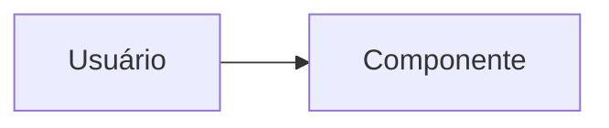

# Plano técnico — [Nome da feature/projeto]

> Status: RASCUNHO | EM REVISÃO | **APROVADO em AAAA-MM-DD por [autor]**
> Spec: `./spec.md` (deve estar APROVADA antes deste plano)

## 1. Resumo da abordagem
[Como a solução atende à spec, em um parágrafo.]

## 2. Stack e versões
| Componente | Versão | Por quê |
|---|---|---|
| [ex.: Python] | [3.12] | [motivo] |

[Versões conferidas na documentação atual em AAAA-MM-DD.]

## 3. Arquitetura

[Explicação dos componentes e do fluxo.]

## 4. Estrutura do repositório (específica deste projeto)
```
[árvore de pastas proposta]
```

## 5. Rastreabilidade
| Requisito / CA | Componente / arquivo | Teste ou execução que verifica |
|---|---|---|
| RF-01 / CA-01.1 | [arquivo] | [teste ou comando] |

## 6. Plano de demonstração e evidências
| Cenário | Como executar (comando exato) | Evidência gerada | Print necessário? |
|---|---|---|---|
| CD-01 | [comando] | `evidence/[arquivo].txt` | [sim/não — qual tela] |

`evidence/manifest.json` registrará: data, git sha, versões, modelo de LLM, região e comando de cada cenário.

Trechos candidatos ao artigo (marcar com `# region: nome` / `# endregion`): [lista]

## 7. Estratégia de testes
[Unitários, integração, e2e; como lidar com respostas não determinísticas de LLM.]

## 8. Infraestrutura, custo e teardown
- Recursos: [lista] — projeto/ambiente de teste: [qual]
- Custo estimado por execução: [valor]
- Deploy: [comando/script] · Teardown: [comando/script]

## 9. Riscos e decisões
| Decisão | Alternativas consideradas | Trade-off |
|---|---|---|

## 10. Verificação de princípios
Conferir contra `principios-projeto-demonstrativo.md` da skill:
- [ ] Demonstrabilidade · [ ] Evidência real · [ ] Reprodutibilidade · [ ] Legibilidade didática
- [ ] Testes ligados à spec · [ ] Segurança/privacidade · [ ] Custo controlado

## 11. Aprovação
- [ ] Autor aprovou o plano (data: ____)
